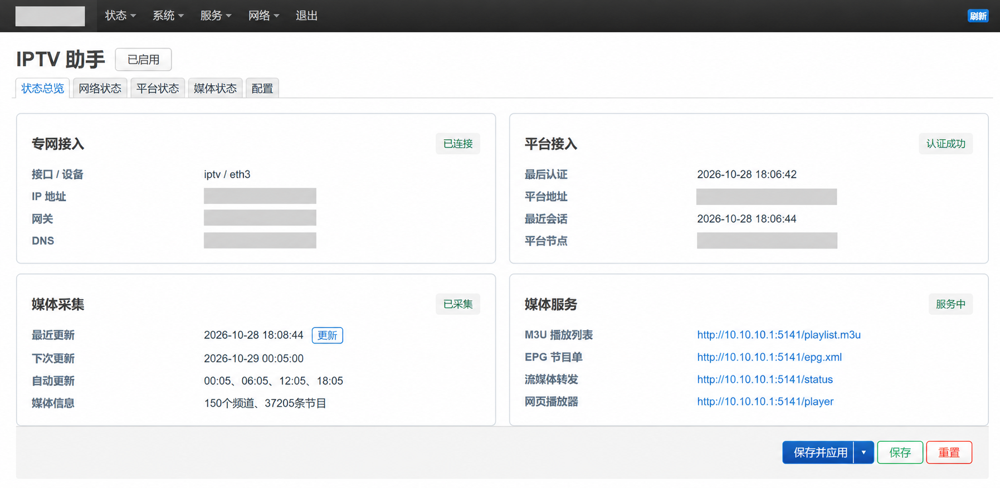
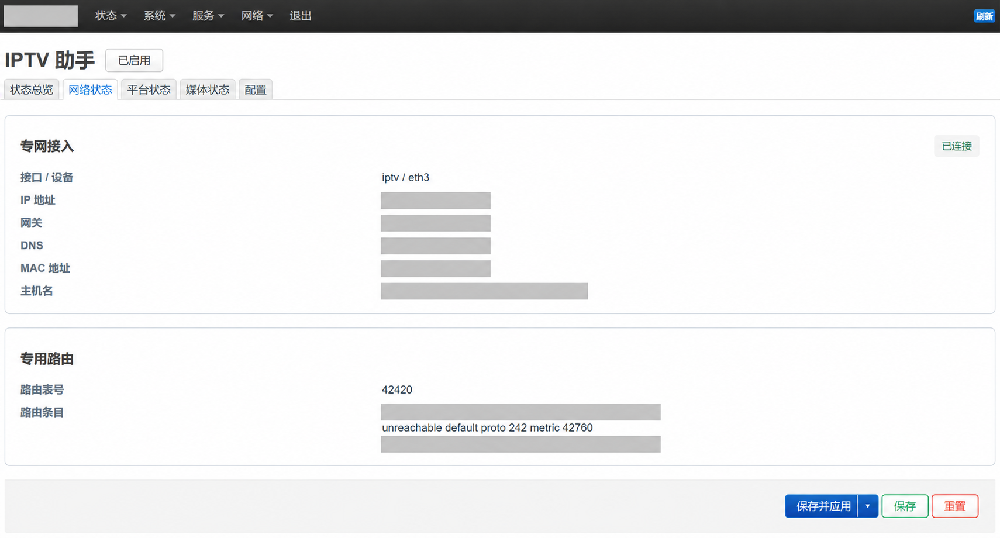
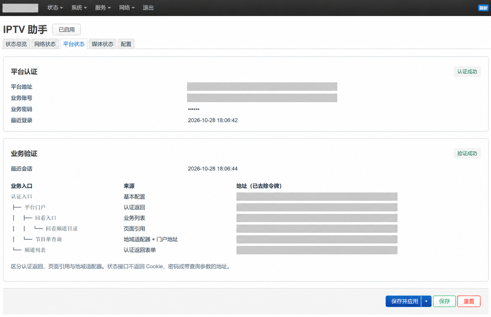
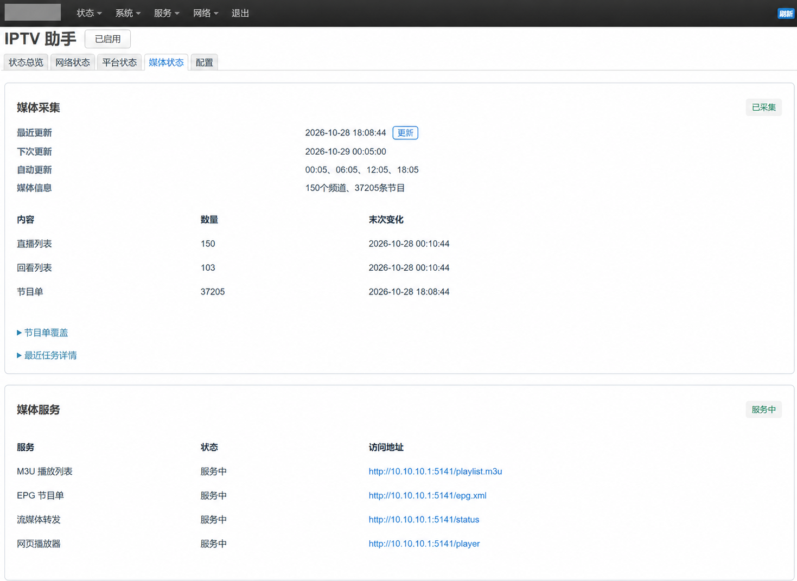

# OpenWrt IPTV Helper

IPTV 助手是一款 OpenWrt LuCI 插件，用于登录运营商 IPTV 平台、采集频道和节目单，并生成播放器可用的 M3U 播放列表与 XMLTV 节目单。配合 [rtp2httpd](https://github.com/stackia/rtp2httpd)，可在局域网内观看直播、回看节目，或直接使用网页播放器。

当前版本为 `luci-app-iptvhelper 0.4.1-r1`，已在 **辽宁联通华为平台、OpenWrt 25.12 x86_64** 环境验证。其他运营商、平台和架构尚需适配与验证。

## 主要功能

- **平台接入**：认证、会话复用和业务入口发现。
- **媒体采集**：频道与节目单存入 SQLite，支持每日定时采集和手动更新。
- **媒体发布**：生成包含回看信息的 M3U 和通用 XMLTV，通过 rtp2httpd 提供访问与播放。
- **LuCI 管理**：查看网络、认证、采集和服务状态，配置接口、平台及采集计划。
- **独立路由**：通过 IPTV 专用路由表访问运营商网络，避免改动普通上网默认路由。

## 界面预览

点击图片查看大图。截图已脱敏，媒体服务地址保留用于展示访问入口。

<a href="docs/screenshots/overview.png"></a>

<details>
<summary>展开更多截图：网络、平台、媒体与网页播放器</summary>

| 网络状态 | 平台状态 |
| --- | --- |
| <a href="docs/screenshots/network.png"></a> | <a href="docs/screenshots/platform.png"></a> |
| 媒体状态 | 网页播放器（rtp2httpd） |
| <a href="docs/screenshots/media.png"></a> | <a href="docs/screenshots/player.png"></a> |

网页播放器的界面与播放能力由 [rtp2httpd](https://github.com/stackia/rtp2httpd) 提供，频道和节目单由 IPTV 助手采集整理。

</details>

## 安装前准备

1. **准备可用的 IPTV 网络接口**：本插件不负责网络接入认证。如需 DHCP+，可使用独立的 [openwrt-dhcpplus](https://github.com/JerryFecl3/openwrt-dhcpplus) 插件；其他接入方式也可以使用。
2. **准备平台地址、业务账号和密码**：用于登录运营商平台。
3. **安装 rtp2httpd**：从 [上游 Releases](https://github.com/stackia/rtp2httpd/releases) 选择匹配固件、架构和包管理器的版本。当前助手安装包将其声明为必需依赖；rtp2httpd 的 LuCI 插件可按需安装。

## 安装与使用

按照 [安装与发布说明](docs/publishing.md) 添加签名公钥和软件源，然后运行：

```sh
apk update
apk add luci-app-iptvhelper
```

首次安装默认停用。在 LuCI 的 **IPTV 助手**中完成配置：

| 配置项 | 填写内容 |
| --- | --- |
| 网络 | 选择已取得地址的 IPTV 接口，默认 `iptv`；路由表默认 `42420`，DNS 默认自动获取。 |
| 平台 | 填写平台地址、业务账号和密码；认证所需 IP、MAC、发送主机名从网络接口读取，主机名未配置时使用系统主机名。 |
| 媒体采集 | 按需启用自动更新，默认每日 `08:00`；EPG 过去/未来天数留空时分别为 7/3 天。 |
| 媒体服务 | 监听地址和端口留空时使用 `0.0.0.0:5141`。 |

启用助手后点击“更新”，完成首次采集。通过媒体服务端口访问：

| 入口 | 用途 |
| --- | --- |
| `/playlist.m3u` | 直播与回看播放列表 |
| `/epg.xml` | XMLTV 节目单 |
| `/player` | rtp2httpd 网页播放器 |
| `/status` | rtp2httpd 转发状态 |

## 使用说明

- 首次完整节目单采集采用串行请求，可能耗时数十分钟；后续会按缓存检查时间跳过尚未到期的记录。
- 网络短暂不可用时保留已采集的数据。自动任务与手动更新共用锁，避免同时执行。
- 当前平台认证支持已验证的六位数字密码格式和 HTTP 平台地址。
- 助手单独管理 rtp2httpd 实例，不覆盖其 `/etc/config/rtp2httpd`，也不接管上游服务实例。Python 不处理实际媒体流量。
- 升级可能短暂中断媒体转发，但不重启网络接口。与其他网络插件的兼容性仍取决于实际路由规则。
- 配置与会话包含敏感信息；媒体端口的访问范围由防火墙或反向代理控制。

## 文档

- [安装、签名公钥与软件源](docs/publishing.md)
- [运行机制与数据存储](docs/operation.md)
- [开发、测试与构建](docs/building.md)
- [验证范围](VALIDATION.md)
- [第三方依赖与许可证](THIRD_PARTY.md)

## 致谢

感谢 [rtp2httpd](https://github.com/stackia/rtp2httpd) 的作者及贡献者。本项目的流媒体转发、网页播放器，以及播放列表和节目单的 HTTP 服务均基于其能力实现。

如果只需要流媒体转发或网页播放器，也可以直接使用 rtp2httpd，按需安装其相关组件。功能介绍和安装方式请参阅 [rtp2httpd 项目文档](https://github.com/stackia/rtp2httpd)。

本项目采用 [MIT 许可证](LICENSE)，第三方依赖遵循各自许可证。
